
<b>English</b> &nbsp;|&nbsp; <a href="README.ru.md">Русский</a>

<a href="https://abdussi-resume.vercel.app"></a>

  <a href="#site">Website&nbsp;›</a>&emsp;
  <a href="#projects">Projects&nbsp;›</a>&emsp;
  <a href="#experience">Experience&nbsp;›</a>&emsp;
  <a href="#stack">Stack&nbsp;›</a>&emsp;
  <a href="#contacts">Contacts&nbsp;›</a>&emsp;
  <a href="resume.pdf">PDF&nbsp;›</a>

 


 
 

  <i>«Real artists ship.»</i> 
  — Steve Jobs

 

 
 

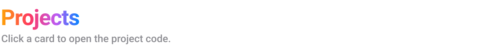

<a href="https://github.com/a1tvv/rentui.kg">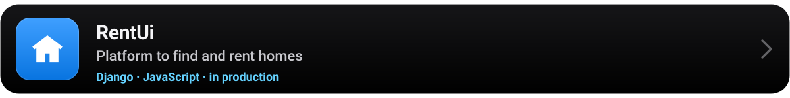</a>
<a href="https://github.com/a1tvv/svet__sunny">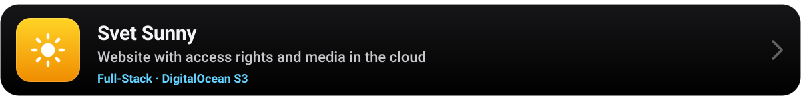</a>
<a href="https://github.com/a1tvv/gb-ansar">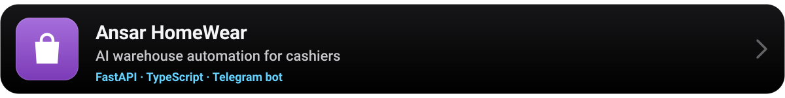</a>

 
 

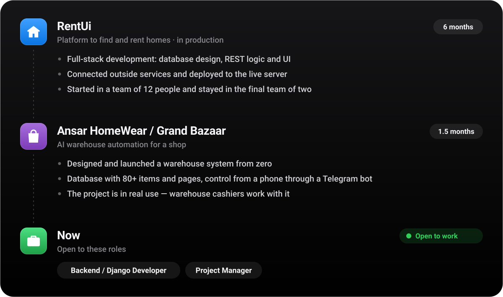

 
 

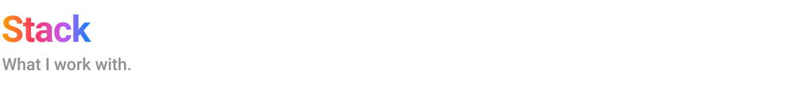

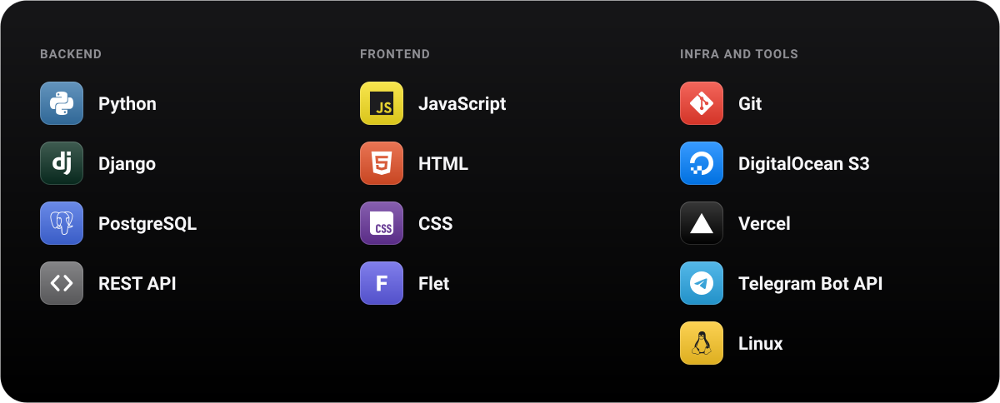

 
 

 
 

 

<a href="resume.pdf">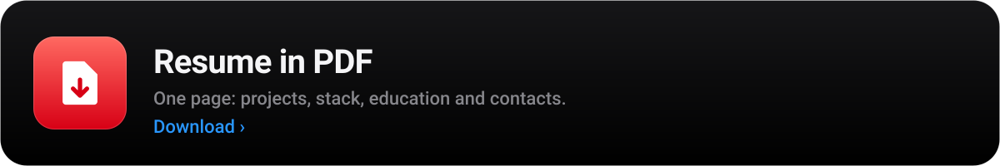</a>

 
 

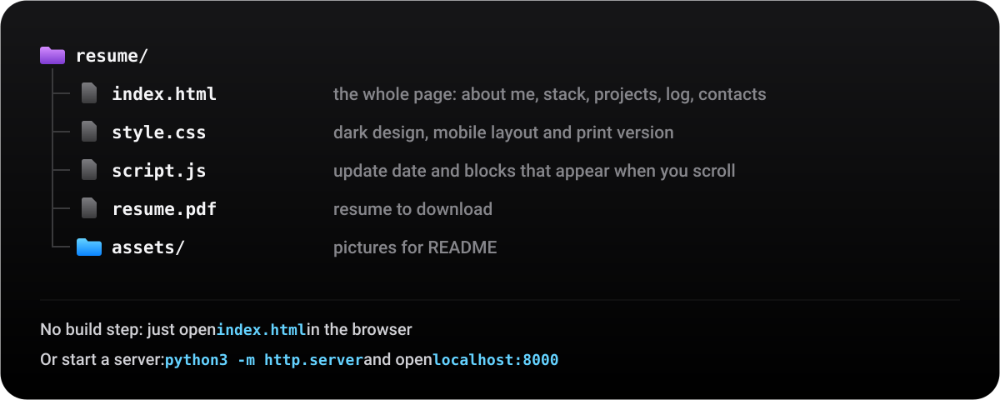

 
 

  © 2026 Altay Abdurakhim &nbsp;·&nbsp; <a href="https://abdussi-resume.vercel.app">abdussi-resume.vercel.app</a>

